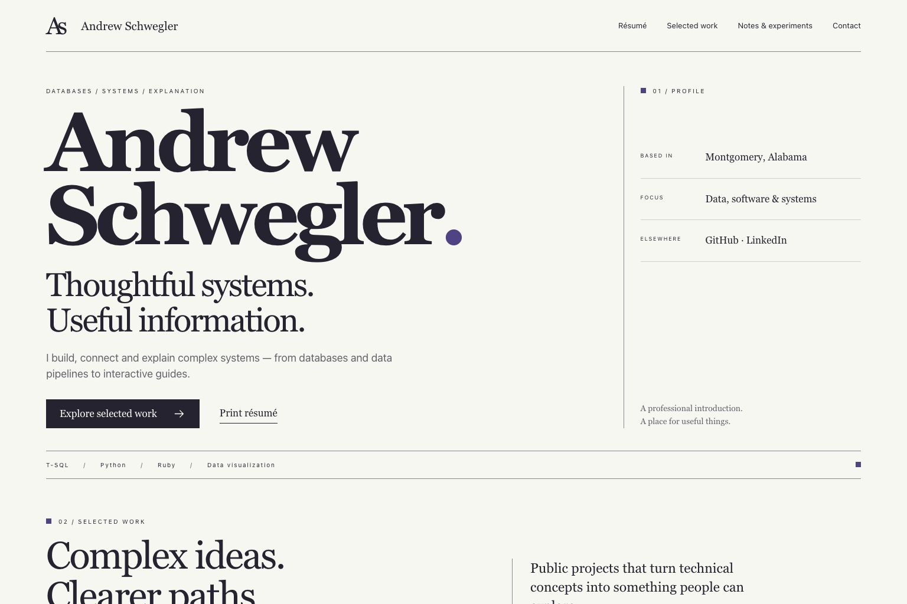
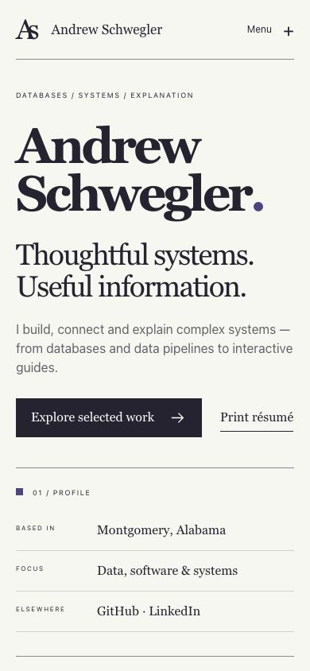
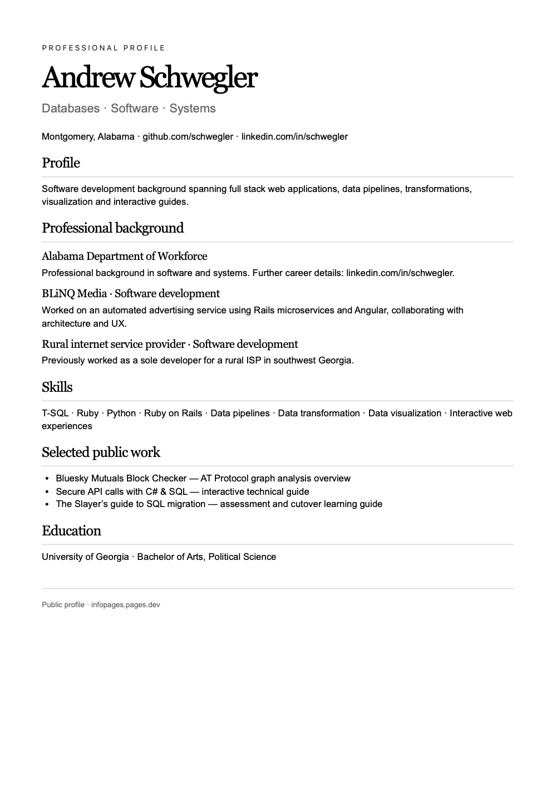

# Implementation review

The approved résumé design is implemented across all eleven routes. This retains the original six project URLs and adds a complete work directory, notes index and print résumé. The professional contact destinations are GitHub, LinkedIn and the blog. Profile metadata uses the same approved public destinations.

## Visual comparison

Chrome browser review compared the approved concept and HTML prototype with the implementation at 1536 × 1024 and 390 × 844. Automated layout checks also covered every route at 320 pixels, including expanded reading sections. The concept and latest browser captures were inspected directly as images.

| Area                  | Comparison and result                                                                                                                      |
| --------------------- | ------------------------------------------------------------------------------------------------------------------------------------------ |
| Name and display type | Two-line serif name, violet period and subordinate statement retain the approved hierarchy.                                                |
| Composition           | Open paper canvas, narrow profile rail, fine rules and skills strip retain their desktop proportions.                                      |
| Color                 | Paper `#f7f7f2`, ink `#242330` and violet `#514287` are unchanged; no gradients or decorative glow added.                                  |
| Navigation            | Same four primary destinations; compact mobile disclosure, visible focus and Escape support. Non-JavaScript navigation is usable.          |
| Content rhythm        | Ruled project rows, open experience/education sections and broader-interest links retain the approved page order.                          |
| Responsive detail     | Profile facts stack, row descriptions move below titles, filters wrap and data stays within the viewport. Long expanded code wraps safely. |
| Print                 | Actual A4 PDF exported, rendered and inspected: one page with complete text, clear margins and no navigation or controls.                  |

Above-the-fold copy matches the approved HTML study except the explicitly requested public-profile link scope. Review-only draft labels and provisional career phrasing are replaced with supported neutral public copy. No dates, numerical accomplishments or exact disputed title were added. No mascots were added to this typographic résumé design.

The implementation was faithfully verified against the approved visual direction. No material visual mismatch remains in the checked compositions. Native HTML controls replace obsolete ambient canvas effects as approved in the prototype. Research values remain clearly identified as illustrative or awaiting primary-source verification.

## Functional and security coverage

- Four Node tests cover timeline filtering, related stories, every permission outcome and the four security topics.
- Twenty browser tests cover all routes at 1536/390/320 widths, expanded content, filters, keyboard navigation, navigation without JavaScript, SQL payload isolation, migration comparison/security/rehearsal/reset, history filtering/empty/error/retry states, modal focus return, safe rendering of injected text, report/year controls, public profile metadata and print output.
- The browser test server enforces the production `_headers` policy; no CSP violations are accepted.
- Static validation checks 155 local references, every route and sitemap entry, one H1 per page, unique IDs, same-origin runtime assets and explicit Person profile metadata.
- JavaScript syntax, formatting, dependency audit and Python dependency consistency checks pass locally. The Node dependency audit reports zero vulnerabilities.
- The original history JSON is semantically unchanged. The seven terms sections are substantively unchanged.

CI runs the same checks and keeps screenshots plus the exported print PDF in its `site-qa` artifact. No deployment workflow has been added.

## Screenshots

Open content/legal decisions are listed in [content-sources.md](content-sources.md).
