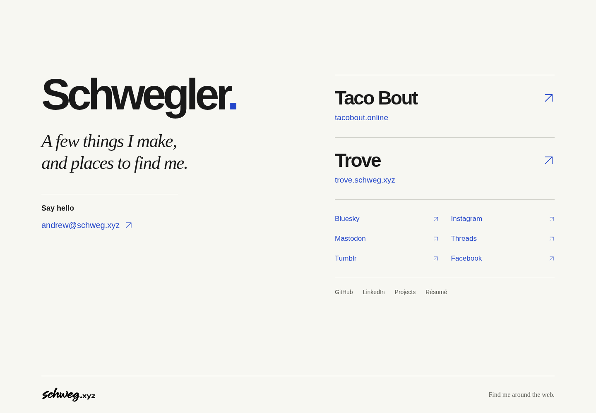
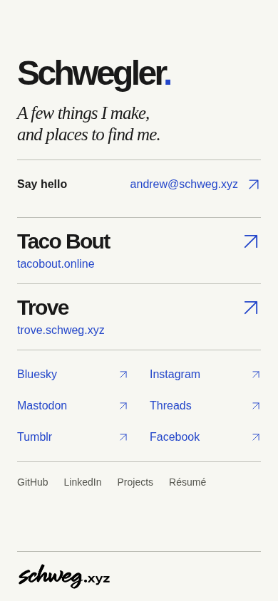
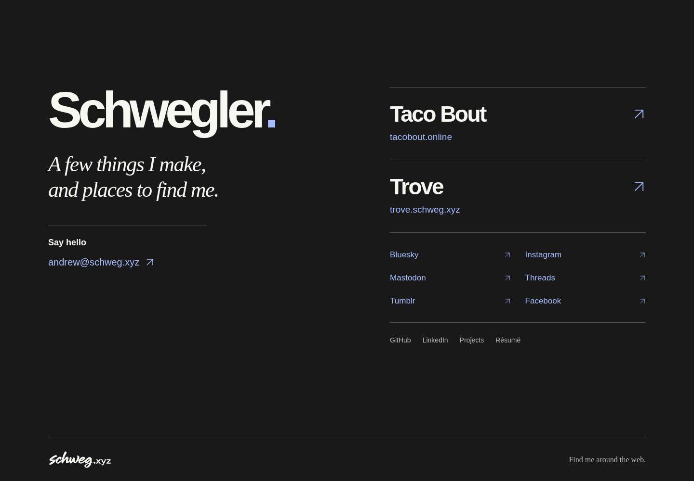

# Personal profile review

The standalone `/me` digital business card uses **Schwegler** only. The résumé and other pages retain their existing content and UI. No framework, JavaScript, remote fonts, analytics, or backend is added. The small blue punctuation mark has a one-time entrance; reduced motion disables it.

## Routes and release checks

- Canonical: `https://schweg.xyz/me`, served by Cloudflare Pages from `me.html`.
- `/about`, `/about/`, and `/about.html`: explicit 301 to `/me`; no existing files collide.
- Existing Notes redirects and security headers are preserved.
- The route inventory and sitemap include the new page. The Bluesky validator exception permits only the verified exact destination on `me.html`; other profile destinations remain rejected.
- Public mail destination and visible address use numeric character references. No email in metadata, ARIA, or data attributes.
- GitHub/LinkedIn, six verified personal social accounts, the two featured destinations, résumé, projects, and the signature home link are native anchors. Some social providers block automated public fetches; identity evidence is separate from live availability.
- Production routing must be checked after an authorized release. Local route tests emulate Pages behavior; they do not prove a deployment. No merge, deployment, account, DNS, or security changes are part of this change.

## Visual review

Image Gen produced complete desktop/mobile concepts before implementation, then a revised full-screen concept and final surname-only concept. Final local concept: `/workspace/generated_images/exec-048e9ec5-c2e9-46a0-a3b9-8abbcf5ab8b3.png`. Generated concept artwork is not shipped. The supplied signature PNG remains authoritative: the concept's invented signature is intentionally replaced with the exact approved asset.

Browser tools were unavailable in this environment, so Playwright Chromium was used over local HTTP with the repository CSP. No certificate warnings were bypassed. Both final concept and latest desktop/mobile render were inspected with `view_image`. Captures: desktop 1440×1000, mobile 390×844, small mobile 360×740, dark desktop 1440×1000, short landscape 844×390. The normal desktop and phone fill their viewport; short screens can scroll without clipping.

| Comparison          | Review / implementation decision                                                                                                                                                                                                     |
| ------------------- | ------------------------------------------------------------------------------------------------------------------------------------------------------------------------------------------------------------------------------------ |
| Typography          | Bold title-case system sans name, italic Georgia supporting copy, quiet sans navigation; surname only. No remote font dependency.                                                                                                    |
| Hierarchy           | Name and statement lead; two featured rows precede the personal social grid and secondary links.                                                                                                                                     |
| Palette             | Paper `#f7f7f2`, ink `#191919`, cobalt `#2346ca`; dark mode has independently legible light text and links.                                                                                                                          |
| Spacing             | Open two-column desktop, single-column mobile, fine rules; all link targets are at least 44px tall.                                                                                                                                  |
| Branding            | Exact 1945×576 approved PNG at natural aspect ratio; 132px display width, light variant on dark backgrounds. No mascot or generated avatar.                                                                                          |
| Copy                | No full name, descriptions, experience, metrics, testimonials, or invented account links. Final concept contact label is supplemented with the verified encoded public address; social order follows row-major native reading order. |
| Responsive / motion | Dynamic viewport and safe-area sizing; scrolling retained for short landscape and zoom. Reduced motion removes entrance animation.                                                                                                   |

Intentional concept deviations: exact approved signature replaces generated artwork; actual public email replaces the concept's generic contact treatment; code-native system typography and accessible 44px targets take priority over raster mockup letterforms and tiny secondary controls. These are documented rather than claiming pixel-identical concept fidelity. The page was reviewed against the final concept for hierarchy, palette, typography character, spacing and asset treatment.

## Screenshots

